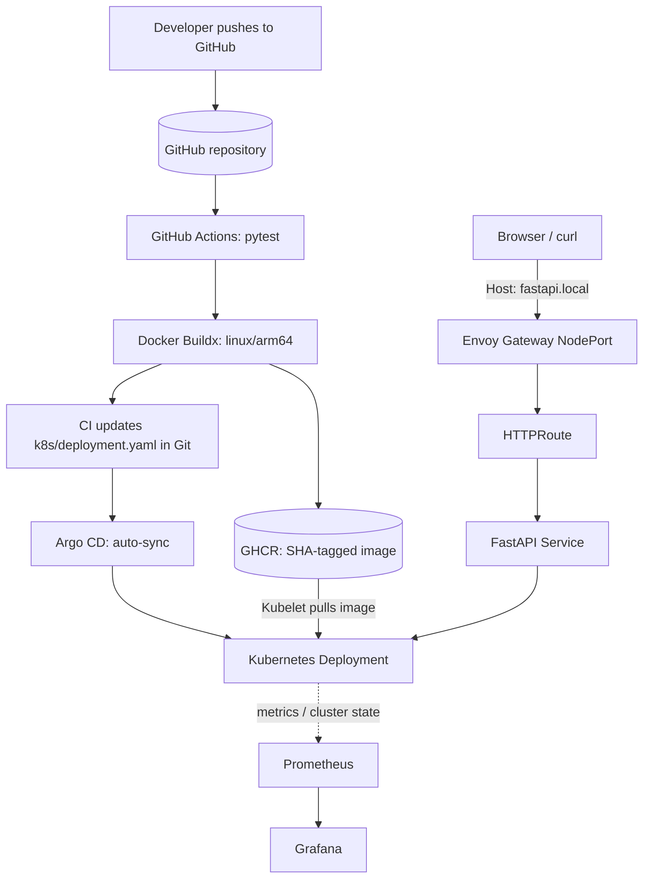
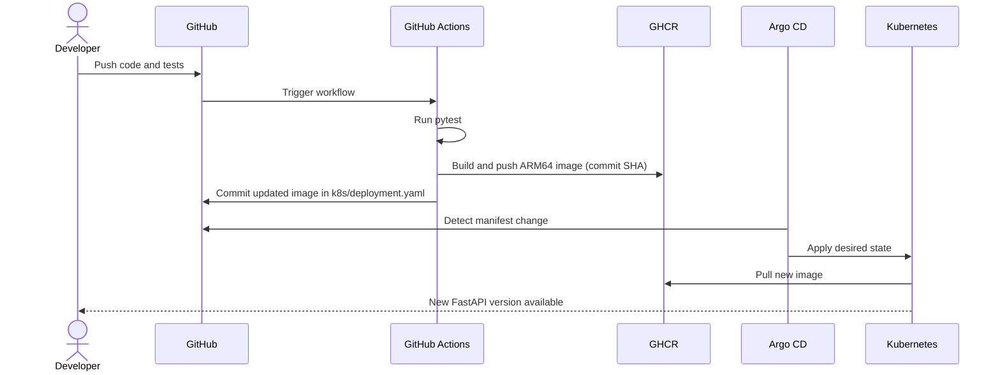

# ARM64 Kubernetes CI/CD & GitOps Homelab

A self-hosted, two-node **ARM64 Kubernetes homelab** that deploys a Python FastAPI application using **GitHub Actions → GitHub Container Registry (GHCR) → Argo CD → Kubernetes**. It also uses **Envoy Gateway** for HTTP routing and **Prometheus + Grafana** for cluster observability.

> **Project outcome:** Updating the FastAPI `/version` endpoint from `1.0.0` to `1.1.0`, committing the code and its tests, and pushing to GitHub resulted in a new ARM64 image, an updated Kubernetes manifest, and an automatically synchronized deployment. The `/version` endpoint returned `{"version":"1.1.0"}`.

## Architecture



### Lab environment

| Component | Implementation |
|---|---|
| Host | Apple Silicon Mac running VMware Fusion |
| Nodes | 2 Ubuntu ARM64 VMs: 1 control plane + 1 worker |
| Kubernetes | kubeadm-based cluster, containerd, Flannel |
| Application | FastAPI with `/`, `/health`, `/version` |
| CI | GitHub Actions: pytest, Docker Buildx, ARM64 image publishing |
| Registry | `ghcr.io/knthbyj/k8s-cicd-lab` |
| CD | Argo CD Application `fastapi-demo`, automated sync |
| Ingress | Envoy Gateway / Kubernetes Gateway API HTTPRoutes |
| Observability | kube-prometheus-stack: Prometheus, Grafana, node-exporter, kube-state-metrics |

## Repository structure

```text
k8s-cicd-lab/
├── .github/workflows/ci.yaml   # Test → build → update manifest
├── app/main.py                  # FastAPI application
├── tests/                       # pytest tests
├── k8s/
│   ├── deployment.yaml          # 2 replicas; image updated by CI
│   ├── service.yaml
│   └── httproute.yaml
├── Dockerfile
├── requirements-dev.txt
└── README.md
```

## What I built — in order

1. **Provisioned the cluster:** Created two ARM64 Ubuntu VMs, initialized Kubernetes, joined the worker, configured containerd and Flannel, and verified both nodes were `Ready`.
2. **Installed ingress routing:** Deployed Envoy Gateway, configured a Gateway with an HTTP listener, and exposed it through NodePort. Created hostname-based HTTPRoutes for services such as Nginx, Grafana, Argo CD and FastAPI.
3. **Added observability:** Installed `kube-prometheus-stack` via Helm; explored Kubernetes CPU/memory metrics and Grafana dashboards.
4. **Created the application:** Built a FastAPI service with `/health` and `/version`, added pytest tests, and packaged it in a Docker image.
5. **Built CI:** Configured GitHub Actions to run tests, then use QEMU + Docker Buildx to publish `linux/arm64` images to GHCR with `latest` and commit-SHA tags.
6. **Declared Kubernetes resources in Git:** Added a Deployment (2 replicas), Service and HTTPRoute under `k8s/`.
7. **Installed Argo CD:** Exposed its UI through Envoy Gateway, connected the public GitHub repository, created the `fastapi-demo` Application and enabled Auto-Sync.
8. **Completed the CI-to-CD handoff:** Added a GitHub Actions job dependent on the successful image build. It updates the Deployment's image reference to the published commit-SHA tag and commits that manifest change to Git.
9. **Verified end to end:** Changed the application and test expectation to `1.1.0`, pushed to GitHub and confirmed that the live endpoint returned the new version.

## How deployment works



**Why SHA tags?** A Deployment that always references `:latest` doesn't change its YAML when a new image is published, so Argo CD has no new desired state to apply. Updating the manifest to the build's commit-SHA tag creates a traceable Git change that triggers a rollout. The image must be published **before** CI updates the manifest; the workflow enforces this using `needs: build`.

**Why all services share the Gateway NodePort:** That port belongs to the Envoy Gateway's NodePort Service. Envoy reads the request hostname and forwards traffic to the matching HTTPRoute and backend Service.

## Reproduce the application deployment

### Prerequisites

- A working ARM64 Kubernetes cluster and `kubectl` access.
- Envoy Gateway installed with a Gateway and an HTTP listener.
- Argo CD installed and able to reach GitHub.
- A public GHCR image, or a configured Kubernetes image pull secret for private images.
- GitHub Actions enabled, with permission to publish packages and update repository contents.

> The cluster bootstrap, Helm installation, Gateway setup and storage provisioning are **not fully automated by this repository**. These instructions document the application deployment and GitOps workflow; they are not a one-command cluster installer.

### 1. Clone the application repository

```bash
git clone https://github.com/knthbyj/k8s-cicd-lab.git
cd k8s-cicd-lab
```

### 2. Run tests

```bash
python -m pip install -r requirements-dev.txt
python -m pytest -v
```

### 3. Check the manifests

```bash
kubectl get gateway -A
kubectl get httproute -A
kubectl get deployment fastapi-demo -n default
```

The `k8s/httproute.yaml` must reference the Gateway name and namespace used by your cluster. If the Gateway uses namespace label selectors, the target namespace must be permitted by the Gateway's `allowedRoutes` configuration.

### 4. Create an Argo CD Application

In the Argo CD UI, create an Application using:

| Field | Value |
|---|---|
| Name | `fastapi-demo` |
| Project | `default` |
| Repository | `https://github.com/knthbyj/k8s-cicd-lab.git` |
| Revision | `HEAD` |
| Path | `k8s` |
| Cluster | `https://kubernetes.default.svc` |
| Namespace | `default` |
| Sync policy | Automated; initially keep Prune and Self Heal disabled |

Confirm that the Application becomes **Synced** and **Healthy**. These statuses are different: Synced means manifests match Git; Healthy indicates the application resources report healthy status.

### 5. Configure CI/CD

The workflow at `.github/workflows/ci.yaml` follows this dependency chain:

```text
test → build (linux/arm64 + push to GHCR) → update-manifest
```

The `update-manifest` job needs `contents: write` permission. Repository rules must allow the workflow to push the generated manifest commit; otherwise use a pull-request-based update. Prevent CI loops by ignoring manifest-only pushes or by relying on the usual `GITHUB_TOKEN` event-trigger behavior.

### 6. Push a code change and verify

Update the FastAPI `/version` response and its corresponding test, then:

```bash
python -m pytest -v
git add app/ tests/
git commit -m "Bump FastAPI version"
git push origin main
```

Watch the GitHub Actions `test`, `build` and `update-manifest` jobs. After Argo CD syncs:

```bash
kubectl rollout status deployment/fastapi-demo
kubectl get deployment fastapi-demo \
  -o jsonpath='{.spec.template.spec.containers[0].image}{"\n"}'
```

From a machine that can reach the Gateway NodePort:

```bash
curl -H 'Host: fastapi.local' http://<GATEWAY_NODE_IP>:<NODEPORT>/version
```

Observed result from the lab:

```json
{"version":"1.1.0"}
```

> Replace `<GATEWAY_NODE_IP>` and `<NODEPORT>` with the address and port exposed by your own Gateway. If using a browser, add the hostname to local DNS or your hosts file.

## Troubleshooting and lessons learned

### DiskPressure blocked Argo CD and monitoring Pods

During Argo CD installation, the worker reported `DiskPressure`. Argo CD repo-server Pods were evicted, while Grafana and Prometheus had scheduling/startup issues. The VM's virtual disk was ~20 GB, but its root logical volume initially used only ~10 GB. I expanded the LVM root filesystem into unused volume-group space and verified that the worker recovered, allowing workloads to run again.

Useful diagnostic commands:

```bash
kubectl describe node k8-worker01
kubectl describe pod -n argocd <pod-name>
df -h /
lsblk
sudo lvs
```

**Lesson:** Distinguish virtual-disk capacity from partition/LVM filesystem capacity, and inspect eviction events rather than blindly restarting Pods.

### Grafana dashboards disappeared after Pod replacement

Grafana persistence was disabled and no PersistentVolume was configured. UI-created dashboards stored in ephemeral Pod storage were lost when Grafana was replaced.

**Lesson:** Running monitoring software is not the same as making its state durable. Add persistent storage or provision dashboards as code before relying on them.

### Argo CD route was unreachable

The Gateway only accepted HTTPRoutes from namespaces with a specific label. The `argocd` namespace initially lacked `gateway-access=allowed`; adding it allowed the route to attach.

**Lesson:** Namespace selectors help control route attachment, but RBAC must restrict who can modify namespaces and create HTTPRoutes.

### GitOps build-order dependency

A manifest can point to an image that has not been pushed yet, resulting in an image pull failure. The workflow updates `deployment.yaml` **only after** the build-and-push job succeeds.

**Lesson:** CI produces artifacts; CD reconciles declared versions. Publishing a new `:latest` image alone does not cause an Argo CD rollout.

## Current limitations and next improvements

- **No Grafana persistence:** dashboards are not durable across Pod replacement.
- **Single worker:** two application replicas do not provide node-level high availability.
- **Lab HTTP routing:** Argo CD was exposed using insecure HTTP behind Envoy for a trusted lab; production needs TLS and appropriate access controls.
- **Direct manifest commits:** the CI workflow writes to the deployment repository; production workflows should consider review, separate configuration repositories and race-condition handling.
- **Image integrity:** SHA-based tags aid traceability, but image digests offer stronger immutability.
- **No automated rollback gate:** a successful sync does not guarantee the new application version is correct.

## Suggested real screenshots

Add screenshots from your own environment under `assets/`, then uncomment the corresponding Markdown lines:

```markdown
<!--  -->
<!--  -->
<!--  -->
```

Avoid including access tokens, secrets, private IPs you do not wish to publish, or sensitive infrastructure information in screenshots.

## Key takeaways

This project demonstrates hands-on experience with **ARM64 Kubernetes administration, containerized application delivery, CI dependency management, GitOps reconciliation, Gateway API routing, observability, and infrastructure troubleshooting**. The end-to-end version upgrade from `1.0.0` to `1.1.0` validated the full delivery path from Git commit to a running Kubernetes application.
